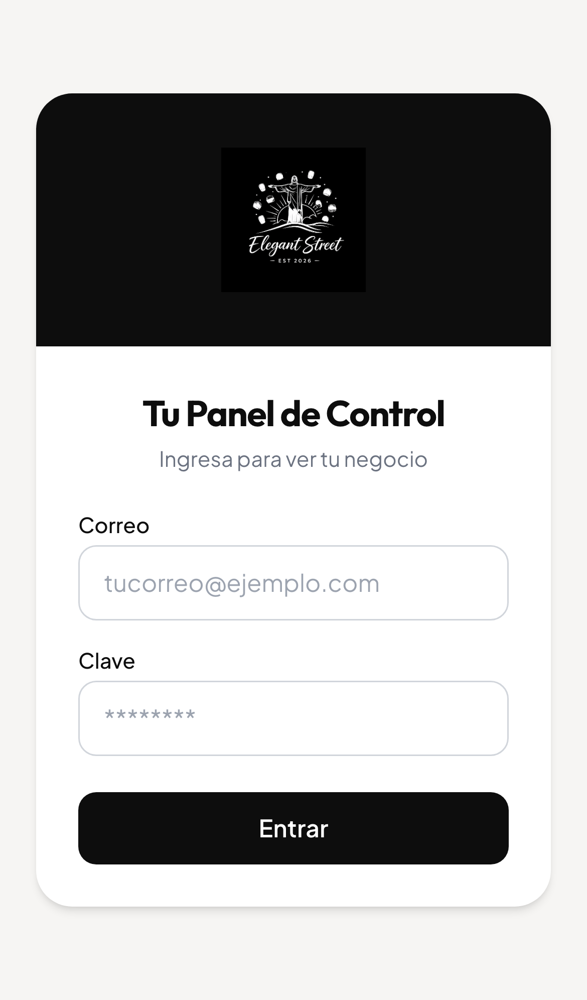
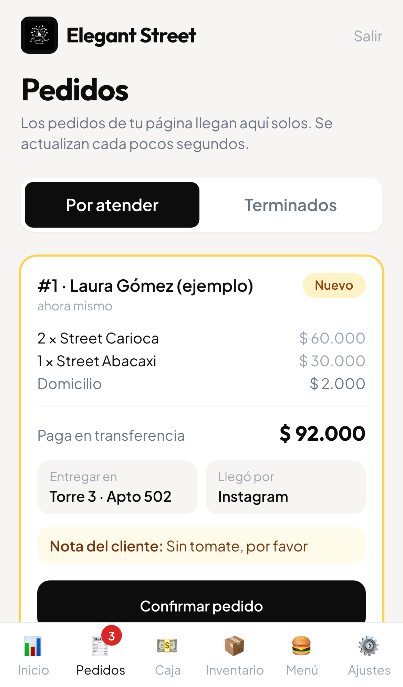
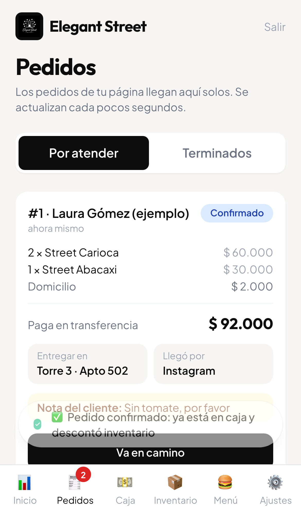
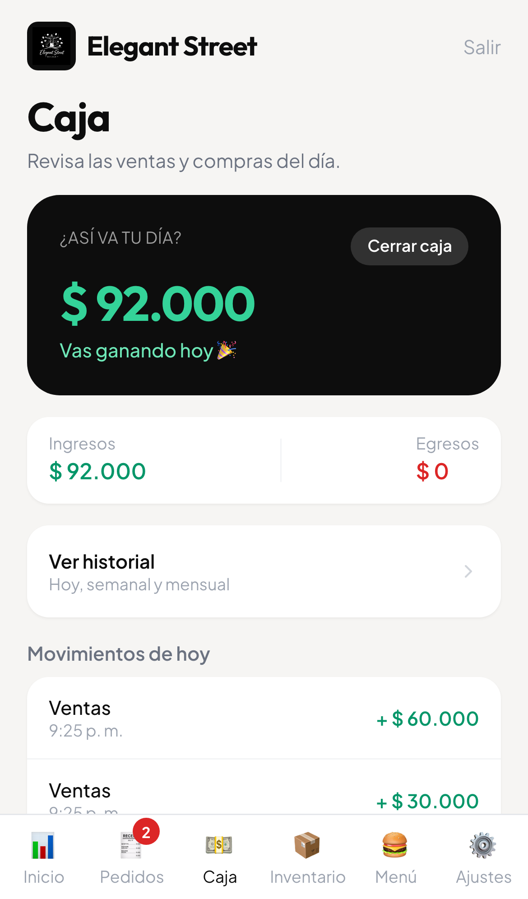
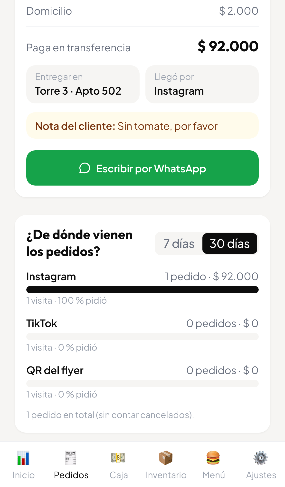
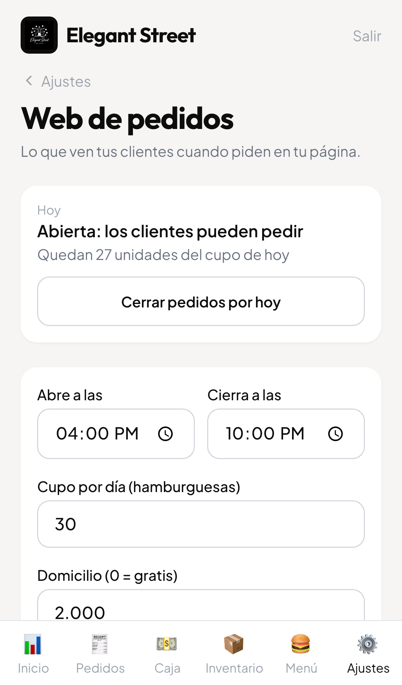

# Entrega Elegant Street: web de pedidos + panel de control

Una sola base de datos (Supabase) para las dos apps:

| Pieza | Qué es | Dónde se publica |
|---|---|---|
| **Web de pedidos** (repo `elegant-street`) | La landing donde los clientes piden | Netlify |
| **Panel de control** (repo `panel-control`) | Lo que usa Sebas: pedidos, caja, inventario, menú | Vercel (proyecto ya existente) |
| **Base de datos** | Pedidos, caja, inventario, menú, usuarios | Supabase (cuenta nueva de Elegant Street) |

Todo se probó en local de punta a punta (ver el final). Nada está publicado todavía.

---

# PARTE 1 · Pasos para Juan (aprox. 50 minutos)

## 0. Antes de empezar: subir el código (5 min)

El trabajo está en ramas locales, sin push:

- `elegant-street`: rama `feat/entrega-unificada` (sale de `feat/pedidos-reales`).
- `panel-control`: rama `feat/pedidos-panel` (sale de `main`).

Haz `git push` de cada una y, cuando las revises, únelas a `main` (PR en GitHub). Netlify y Vercel deben leer esas ramas (o `main` después de unir).

## 1. Crear el Supabase nuevo (10 min)

1. Entra a <https://supabase.com> con la **cuenta nueva** de Elegant Street.
2. **New project**. Nombre: `elegant-street`. **Database password**: toca *Generate a password* y guárdala en un gestor de claves (no en un archivo del repo). Región: **East US (North Virginia)**.
3. Si aparece **Enable Data API**, déjala **encendida**.
4. Espera 1 a 2 minutos a que termine.

> El proyecto viejo `panel-control` (refs `egkenisdeqrbqdemwodk` y `lsgmbwxordjlihjxswte`) era de pruebas. No se reutiliza. Si quieres conservar algún dato de ahí, dímelo antes de borrarlo.

## 2. Pegar el SQL (3 min)

1. **SQL Editor → New query**.
2. Abre `SQL-PARA-PEGAR-ELEGANT.sql` (está en la raíz de los dos repos, es el mismo archivo), copia **todo**, pégalo y toca **Run**.
3. Debe decir *Success*. Si sale un aviso de "destructive operation" (por las líneas `revoke`), toca **Run this query**: no borra datos.
4. Revisa en **Table Editor**: `ajustes`, `catalogo_web`, `jornadas`, `pedidos`, `pedido_items`, `visitas`, `insumos`, `receta`, `ventas`, `transacciones`, `productos`, `variantes_producto`... y en `variantes_producto` deben estar "Street Carioca" y "Street Abacaxi" a $30.000.
5. Se puede volver a pegar sin problema (no duplica nada).

## 3. Login: cerrar el registro, dejar el correo activo (5 min)

Entra a **Authentication → Sign In / Providers**:

- **Email**: debe quedar **ENCENDIDO**. Si lo apagas, nadie puede entrar al panel (ni Sebas).
- Apaga **solo** "**Allow new users to sign up**". Así nadie se puede registrar solo, pero Sebas sí puede entrar con el usuario que tú le creas.
- No actives "Anonymous sign-ins".

Luego crea el usuario de Sebas: **Authentication → Users → Add user → Create new user**.
- Correo: el que Sebas elija.
- Clave: la que Sebas elija (que la escriba él; no la guardes en ningún archivo).
- Marca **Auto Confirm User**.

## 4. Copiar la URL y la llave (2 min)

Botón **Connect** (o **Project Settings → API Keys**):
- **Project URL**: `https://xxxx.supabase.co`
- **Publishable key**: `sb_publishable_...` (la `anon` antigua `eyJ...` también sirve).

Nunca copies la *secret key* ni la *service_role* a ninguna app.

## 5. Publicar la web en Netlify (15 min)

1. <https://app.netlify.com> → **Add new project → Import an existing project → GitHub** → repo `j4mLoz/elegant-street`, rama `main` (o `feat/entrega-unificada` si aún no la uniste).
2. Netlify lee `netlify.toml`; no toques el build.
3. Variables de entorno (nombre exacto):

   | Nombre | Valor |
   |---|---|
   | `SUPABASE_URL` | la Project URL del paso 4 |
   | `SUPABASE_PUBLISHABLE_KEY` | la publishable key del paso 4 |
   | `NEXT_PUBLIC_WHATSAPP_NUMERO` | `573113749498` |

4. **Deploy**. Si cambias una variable después: *Deploys → Trigger deploy*.

## 6. Publicar el panel (15 min)

**Dónde:** en el proyecto de Vercel que ya existe, `panel-control-elegant-street` (así no creas otro). Nota: el plan Hobby de Vercel es para uso no comercial; como Sebas vende con esto, lo correcto es el plan Pro (USD 20/mes) o publicar el panel también en Netlify (funciona igual: mismo repo, mismas dos variables).

**Por qué falló el último deploy (ERROR):** las variables de entorno no estaban cargadas en Vercel. Los archivos `.env` no se suben al repo (correcto, por seguridad) y el código creaba la conexión con valores vacíos, lo que hacía reventar el build con `supabaseUrl is required`. Se reprodujo en local clonando el repo sin los `.env`. Ya está corregido en el código: ahora el build no se cae, y si faltan las variables el login muestra el aviso "Falta conectar la base de datos".

Pasos:
1. En Vercel → proyecto → **Settings → Environment Variables**. Borra las viejas y crea (en **Production**, **Preview** y **Development**):

   | Nombre | Valor |
   |---|---|
   | `NEXT_PUBLIC_SUPABASE_URL` | la Project URL del Supabase **nuevo** |
   | `NEXT_PUBLIC_SUPABASE_ANON_KEY` | la publishable key del Supabase **nuevo** |

2. **Deployments → Redeploy** (o haz push de la rama). Debe quedar en verde.
3. Entra a la dirección del panel con el correo y clave de Sebas.

## 7. Prueba final con un pedido real de prueba (10 min)

1. En el panel: **Ajustes → Web de pedidos → Abrir pedidos por hoy** (si hoy no es vie/sáb/dom).
2. En el celular abre `https://TU-WEB.netlify.app/?src=ig`, haz un pedido de prueba.
3. Se abre WhatsApp con el pedido. Verifica que en el panel aparece en **Pedidos** con origen *Instagram*.
4. Confírmalo, mira que entre a Caja y descuente Inventario. Luego **Cancelar** el pedido (devuelve todo) y **Cerrar pedidos por hoy**.

## 8. Lo que falta cargar para que el inventario descuente de verdad

Confirmar un pedido descuenta inventario **según la receta**. Si no hay recetas, el pedido entra a caja pero no descuenta nada. Entonces, antes de abrir al público (Sebas o tú, 20 min):

1. **Ajustes → Insumos** y **Inicio → Registrar compra**: crear pan, carne, papas, etc., con su stock.
2. **Menú**: abrir "Hamburguesa Street Carioca" y "Street Abacaxi" y configurar la receta de cada una.
3. **Ajustes → Insumos**: poner el costo por unidad (opcional, solo para ver rentabilidad).

Si falta stock al confirmar, el panel avisa "No alcanza el inventario: falta X" y el pedido queda pendiente.

## 9. Links por canal (para bio, estados y el QR)

Cambia `TU-WEB` por la dirección final.

| Dónde | Link |
|---|---|
| Bio de Instagram | `https://TU-WEB.netlify.app/?src=ig` |
| Bio de TikTok | `https://TU-WEB.netlify.app/?src=tiktok` |
| Estados y mensajes de WhatsApp | `https://TU-WEB.netlify.app/?src=wa` |
| Facebook | `https://TU-WEB.netlify.app/?src=fb` |
| QR del flyer | `https://TU-WEB.netlify.app/?src=qr` |
| Anuncios pagados | `https://TU-WEB.netlify.app/?src=pauta` |

Para separar campañas: `&c=` (ejemplo `?src=qr&c=flyer-octubre`). No imprimas el QR hasta tener el dominio definitivo.

## 10. Pendientes de decisión (necesito de Sebas)

- Cupo: hoy 30 por día (total de hamburguesas). Confirmar si es por día o total.
- Llave/número para transferencias (campo en Ajustes → Web de pedidos).
- Si se cobra domicilio dentro de la unidad (hoy 0).
- Fotos reales de Carioca y Abacaxi.
- Dominio definitivo y quién paga el plan de Vercel/Netlify.

## Seguridad: qué quedó cerrado

- La web (llave pública) **no puede leer ni escribir tablas**. Solo ejecutar 3 funciones: ver si está abierto, crear pedido y registrar visita. Nunca lee pedidos.
- El precio y el cupo se calculan en la base, no en el navegador del cliente.
- El panel exige correo y clave. No hay registro público y no existe `/admin` en la web.
- Todas las tablas tienen RLS. Los permisos (GRANT) están escritos de forma explícita en el SQL.
- Sebas solo puede cambiar el estado de un pedido; no puede alterar total ni datos del cliente.
- No hay llaves ni claves en el repo (`.env.example` solo trae los nombres).

---

# PARTE 2 · Guía para Sebas (6 pasos)

## 1. Entra a tu panel

Abre la dirección del panel en tu celular, escribe tu correo y tu clave y toca **Entrar**.

## 2. Mira los pedidos nuevos

Toca **Pedidos** (abajo). Un globito rojo te dice cuántos pedidos nuevos hay. Cada tarjeta muestra qué pidió, el total, la **torre y apartamento**, cómo paga, la nota del cliente y por dónde llegó (Instagram, QR, etc.). Se actualiza sola.

## 3. Confirma el pedido

Toca **Confirmar pedido**. Con ese toque el panel **suma la venta a la caja y descuenta el inventario** solo. Si falta algo de inventario, te avisa cuál es.

## 4. Habla con el cliente

Toca el botón verde **Escribir por WhatsApp**: abre el chat con el cliente y un mensaje ya escrito. Úsalo para confirmar, avisar que va en camino o resolver dudas.

## 5. Avanza el pedido

Cuando salga, toca **Va en camino**; al entregarlo, **Ya se entregó**. Si algo falla, toca **Cancelar**: se devuelve el inventario y se quita de la caja.

## 6. Revisa tu negocio

- **Caja**: lo que entró hoy, ya con los pedidos.
- **Inventario**: lo que te queda.
- En **Pedidos → Terminados** está la tarjeta **¿De dónde vienen los pedidos?** para saber qué te trae más clientes.

**Extra: abrir o cerrar la página.** En **Ajustes → Web de pedidos** puedes cerrar los pedidos por hoy (por ejemplo, si se acabó todo), cambiar el horario, el cupo, el domicilio y dónde te transfieren.

---

# Cómo se probó (para Juan)

Prueba local con Supabase local (Docker), datos ficticios. Resultado: **todo pasa**.

- `tests/pruebas-db.sql` (20 pruebas de permisos y flujo en la base).
- `tests/e2e-pedidos.cjs` (32 comprobaciones con navegador: la web crea 3 pedidos, aparecen en el panel, confirmar crea ventas y descuenta inventario, cancelar lo deshace, login, registro cerrado, `anon` sin acceso a pedidos).
- `elegant-street/tests/pedidos.e2e.cjs` (21 pruebas de la web: horario, cupo, spam, atribución).

Cómo repetirlas: ver `README.md`.
